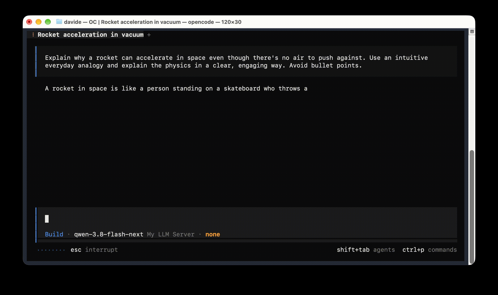
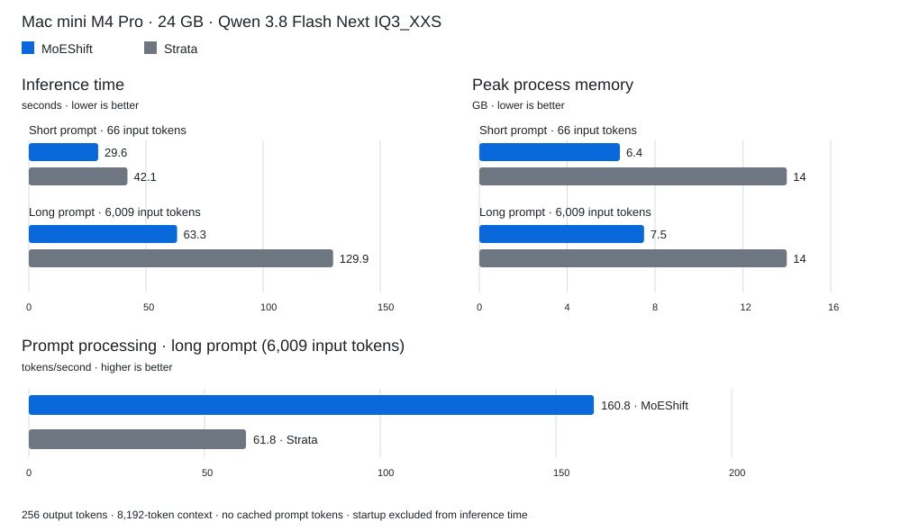

# MoEShift

**Large AI models on your Mac. Starting with 10 GB of RAM.**

**125 billion parameters. Up to 11 tokens per second. Under 10 GB of
peak process memory.** MoEShift is optimized for Apple Silicon: on a Mac mini
M4 Pro with 24 GB of unified memory, it runs Qwen 3.8 Flash Next with roughly
half the peak process memory of Strata and processes long prompts 2.6× faster.

MoEShift leaves room for your other apps, helping your Mac stay responsive during inference
instead of grinding to a halt under memory pressure. Keep browsing, writing
and coding while the model works—all locally, with no cloud subscription.



*Qwen 3.8 Flash Next running locally with MoEShift, connected to OpenCode.*

**Alpha release.** The core runtime is working, and the project is evolving
quickly. You may encounter rough edges; your feedback helps shape the next release.
Tested models and quantizations are listed below.

## Tested models and benchmarks

| Model | GGUF architecture | Tested quantization |
|---|---|---|
| Qwen 3.8 Flash Next (125B) | `qwen4exp` | ISTA-DASLab GSQ-RCO IQ3_XXS |
| Qwen3.6-35B-A3B | `qwen35moe` | UD Q6_K XL (Q6_K/Q8_0 experts) |

Both use the shared SSD expert runtime on Apple Silicon. See
[supported architectures and capabilities](docs/supported-architectures.md).

### Qwen 3.8 Flash Next

Compared with **Strata**, a popular choice for local MoE inference, on a
**Mac mini M4 Pro with 24 GB unified memory**. Both ran Qwen 3.8 Flash Next
(125B), ISTA-DASLab GSQ-RCO IQ3_XXS, with an 8,192-token context, no cached prompt
tokens and 256 output tokens. Strata: 0.2.7, build 0.1.52.



| Measurement | Short prompt: MoEShift / Strata | Long prompt: MoEShift / Strata |
|---|---|---|
| Input tokens | 66 / 66 | 6,009 / 6,009 |
| Inference time ↓ | **29.6 / 42.1 s** | **63.3 / 129.9 s** |
| Prompt processing ↑ | — | **160.8 / 61.8 tok/s** |
| Text generation ↑ | **10.44 / 8.4 tok/s** | **9.9 / 7.8 tok/s** |
| Peak process memory ↓ | **6.4 / 14 GB** | **7.5 / 14 GB** |

Time includes server-measured prompt processing and generation, excluding
startup. Memory is macOS `footprint -p` peak physical process footprint.

### Qwen3.6-35B-A3B

UD Q6_K XL on the same Mac mini M4 Pro with 24 GB unified memory.
Medians of three measured runs after warmup, with no cached prompt tokens and
512 output tokens, using the [benchmark runner](benchmarks/README.md).
These runs use different output lengths from the Flash Next comparison above.

| Measurement | Short prompt | Long prompt |
|---|---|---|
| Input tokens | 72 | 6,060 |
| Inference time ↓ | **34.25 s** | **49.45 s** |
| Prompt processing ↑ | - | **417.24 tok/s** |
| Text generation ↑ | **16.50 tok/s** | **14.66 tok/s** |
| Peak process memory ↓ | **5.4 GB** | **5.6 GB** |

## What you need

- A **Mac with Apple Silicon** (M-series).
- At least **10 GB of RAM**.
- A fast SSD with space for both the GGUF and prepared expert files: at least
  **120 GB** for the Flash Next setup below, or **61 GB** for Qwen3.6 UD Q6_K XL.
- [Homebrew](https://brew.sh/), the package manager for macOS. If you have never
  used it, follow its installation instructions, then return here.

## Quick install

Open Terminal and run:

```sh
brew install davide-troiani/moeshift/moeshift
moeshift
```

The first launch opens the setup wizard. You just choose the model: it will download it from HuggingFace (uses `hf` for faster download) and configure MoEShift automatically.

**Prefer to configure it yourself or try your own model?** Choose **Manual configuration**. See the [configuration reference](configs/README.md).

### Try a message from Terminal

Open another Terminal and run:

```sh
curl http://127.0.0.1:8080/v1/chat/completions \
  -H 'Content-Type: application/json' \
  -d '{"model":"qwen-3.8-flash-next-rco-gsq-iq3-xxs","messages":[{"role":"user","content":"Say hello in one sentence."}],"chat_template_kwargs":{"enable_thinking":false},"max_tokens":128,"stream":false}'
```

### Connect your chat or coding application

In any client that supports an OpenAI-compatible API, enter:

| Field | Value |
|---|---|
| Base URL | `http://127.0.0.1:8080/v1` |
| Model | `qwen-3.8-flash-next-rco-gsq-iq3-xxs` |

MoEShift handles one inference request at a time and listens only on localhost.


## Architecture

Read the [MoEShift architecture](docs/architecture.md) for the project’s design:
LES (Lookahead Expert Scheduling), expert loading and Metal execution, cache
policy, memory management, and server/worker lifetimes.


## Other models

For other supported models, add a
[GGUF model configuration](configs/README.md#ordinary-gguf-models) to the JSON configuration.
See [architectures and capabilities](docs/supported-architectures.md) for the
verification status and tools for media, speech and embeddings.

## Adjust speed and memory use

You can adjust these settings in the configuration file to suit your Mac.
With more RAM, you can increase `moe-prefill-bank` and
`LLAMA_MOE_PROTECTED_SLOTS` to keep more model data in memory and reduce SSD
reads. Lower them to use less RAM. For better control, change one setting at a time and restart
MoEShift to apply it.

| Setting | Default | Direct effect |
|---|---|---|
| `args.ctx-size` | `65536` | Maximum conversation length in tokens. Lower it to limit memory growth during long conversations; raise it to allow longer conversations, with more memory use as they grow. |
| `args.moe-prefill-bank` | `512` / `256`¹ | Expert cache used when reading your prompt. More slots can reduce SSD reads and speed up prompt processing, using more RAM; fewer slots save RAM. |
| `args.prefill-max-tokens` | `3072` | Amount of prompt text processed per batch. Smaller batches reduce peak working memory; larger batches can improve prompt-processing speed. |
| `env.LLAMA_MOE_PROTECTED_SLOTS` | `24` | Extra experts kept in memory while generating replies. More slots can reduce SSD reads and improve speed, using more RAM; fewer slots save RAM. |
| `args.threads` | `10` | CPU threads available to inference. More threads can help CPU work but compete with other apps; more is not always faster. |
| `env.LLAMA_GPU_KEEPALIVE` | `1` | Keeps the GPU active to reduce wake-up delays. Set to `0` to reduce idle GPU activity and power use, but expect lower speeds. |
| `env.LLAMA_MOE_QUIET` | `1` | Keeps expert diagnostics out of Terminal. Set to `0` for more detail when investigating a problem. |
| `port` | `8080` | Change this if another application already uses the port; use the same port in your client. |

¹ Flash Next / Qwen3.6. Slot sizes depend on the model and quantization;
equal slot counts do not imply equal memory use. The Flash Next defaults were
tuned on a Mac mini M4 Pro with 24 GB unified memory. The
[full configuration reference](configs/README.md) covers the remaining options,
valid combinations and command-line overrides. Settings under `env` are edited
in this file, rather than exported in Terminal.

## Feedback and issues

Found a problem or have an idea?
[Open an issue](https://github.com/davide-troiani/moeshift/issues/new/choose),
after checking whether someone has already reported it.

Choose **Bug report** for installation, startup or inference problems, or
**Feature request** for suggestions, or **Benchmark result** to share measurements
from your Mac. The form guides you through the useful
information: your Mac chip and RAM, macOS version, MoEShift version, model files,
steps to reproduce and relevant Terminal output. Remove private prompts,
credentials and personal paths before posting.

## Contributing

See [CONTRIBUTING.md](CONTRIBUTING.md) for fixes, suggestions and pull requests.

### Share how MoEShift runs on your Mac

**Help someone with a Mac like yours decide whether MoEShift fits their day.**
Can you keep browsing in Safari while it answers? How does it feel on battery,
or with your usual apps open? Share a benchmark from your MacBook, Mac mini or
Mac Studio—every chip and memory size adds a useful piece of the picture.

You do not need a perfectly idle machine. Keep your normal setup and tell us
what you were doing. The [benchmark runner](benchmarks/README.md) handles the
fixed short and long prompts, repeats the measurements and creates a JSON report
for you. It collects benchmark metrics only; you describe your Mac and working
conditions yourself.

Then [share your results](https://github.com/davide-troiani/moeshift/issues/new?template=benchmark_result.yml)
and attach the report. Screenshots and a few words about how responsive your
other apps felt are welcome too. Your experience can help the next user find
out what to expect—and help us see where MoEShift needs to improve.

## Documentation scope

The alpha targets Apple Silicon Macs. Some remaining documents describe upstream
components and may mention platforms or features outside MoEShift's scope; they
will be cleaned up over time. Start with this README and the
[configuration reference](configs/README.md). Runtime details:
[adaptive prefill](docs/les/adaptive-prefill.md),
[protected cache](docs/les/protected-decode-cache.md), and
[GPU keepalive](docs/les/gpu-keepalive.md).

## Credits and license

MoEShift builds on [tc-mb/llama.cpp-omni](https://github.com/tc-mb/llama.cpp-omni),
[llama.cpp](https://github.com/ggml-org/llama.cpp) and
[ggml](https://github.com/ggml-org/ggml). The MoE-SSD/LES foundations
precede MoEShift's Qwen runtime, Metal scheduling and cache changes. The protected
cache adapts the demand-weighted decay idea from
[LRFU](https://www.openu.ac.il/home/wiseman/2os/lru/lrfu.pdf).

Model and quantization credits belong to their respective authors; the
recommended GGUF files are published by
[ISTA-DASLab](https://huggingface.co/ISTA-DASLab/Qwen3.8-Flash-Next-GSQ-RCO-GGUF).

Original Git history and copyright notices are retained. See [LICENSE](LICENSE)
and the bundled third-party licenses. Model weights retain their own licenses.
