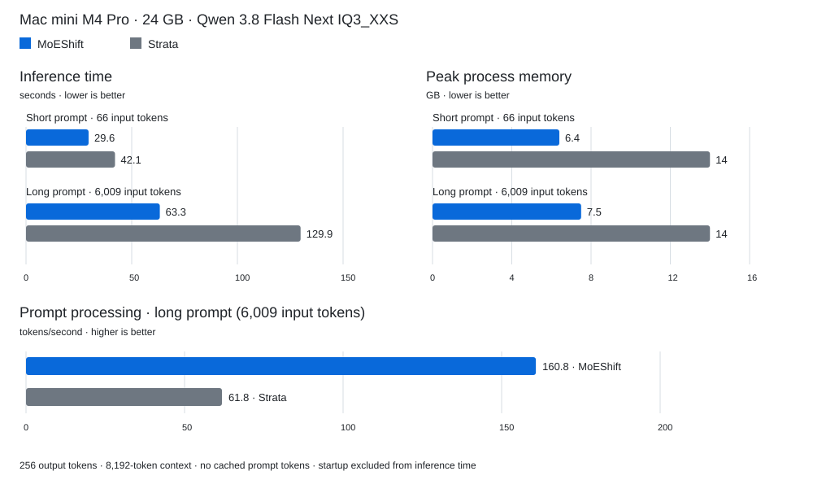

# MoEShift

**Large AI models on your Mac. Starting with 10 GB of RAM.**

**125 billion parameters. Up to 11 tokens per second. Under 10 GB of
peak process memory.** MoEShift is optimized for Apple Silicon: on a Mac mini
M4 Pro with 24 GB of unified memory, it runs Qwen 3.8 Flash Next with roughly
half the peak process memory of Strata and processes long prompts 2.6× faster.

MoEShift leaves room for your other apps, helping your Mac stay responsive during inference
instead of grinding to a halt under memory pressure. Keep browsing, writing
and coding while the model works—all locally, with no cloud subscription.

**Alpha release.** The core runtime is working, and the project is evolving
quickly. You may encounter rough edges; your feedback helps shape the next release. This build
was tested using ISTA-DASLab GSQ-RCO IQ3_XXS so far.

## Benchmarks

Compared with **Strata**, a popular choice for local MoE inference, on a
**Mac mini M4 Pro with 24 GB unified memory**. Both ran Qwen 3.8 Flash Next
(125B), ISTA-DASLab GSQ-RCO IQ3_XXS, with an 8,192-token context, no cached prompt
tokens and 256 output tokens. Strata: 0.2.7, build 0.1.52.



| Measurement | Short prompt: MoEShift / Strata | Long prompt: MoEShift / Strata |
|---|---|---|
| Input tokens | 66 / 66 | 6,009 / 6,009 |
| Inference time ↓ | **29.6 / 42.1 s** | **63.3 / 129.9 s** |
| Prompt processing ↑ | — | **160.8 / 61.8 tok/s** |
| Text generation ↑ | **10.44 / 8.4 tok/s** | **9.9 / 7.8 tok/s** |
| Peak process memory ↓ | **6.4 / 14 GB** | **7.5 / 14 GB** |

Time includes server-measured prompt processing and generation, excluding
startup. Memory is macOS `footprint -p` peak physical process footprint.

## What you need

- A **Mac with Apple Silicon** (M-series).
- At least **10 GB of RAM**.
- A fast SSD with at least **120 GB of free space** for the model and its prepared
  files.
- [Homebrew](https://brew.sh/), the package manager for macOS. If you have never
  used it, follow its installation instructions, then return here.

## 1. Install MoEShift

Open **Terminal** and run:

```sh
brew install davide-troiani/moeshift/moeshift
```

The installation includes model preparation tools. MoEShift creates
`~/.config/moeshift/config.json` automatically on first launch and preserves
your settings on subsequent launches and upgrades.

## 2. Download the model

Use the **IQ3_XXS quantization by ISTA-DASLab**:
[Qwen3.8-Flash-Next-GSQ-RCO-GGUF on Hugging Face](https://huggingface.co/ISTA-DASLab/Qwen3.8-Flash-Next-GSQ-RCO-GGUF/tree/main/IQ3_XXS).
Download **both** files into the same folder, keeping their names:

- [Qwen3.8-Flash-Next-GSQ-RCO-IQ3_XXS-00001-of-00002.gguf](https://huggingface.co/ISTA-DASLab/Qwen3.8-Flash-Next-GSQ-RCO-GGUF/resolve/main/IQ3_XXS/Qwen3.8-Flash-Next-GSQ-RCO-IQ3_XXS-00001-of-00002.gguf?download=true)
- [Qwen3.8-Flash-Next-GSQ-RCO-IQ3_XXS-00002-of-00002.gguf](https://huggingface.co/ISTA-DASLab/Qwen3.8-Flash-Next-GSQ-RCO-GGUF/resolve/main/IQ3_XXS/Qwen3.8-Flash-Next-GSQ-RCO-IQ3_XXS-00002-of-00002.gguf?download=true)

These are large downloads, about **76 GB combined**. If you already have these
exact files, reuse them. MoEShift does not distribute or requantize the model.

## 3. Get the downloaded model ready to use

Run this once to copy the model's specialized parts (“experts”) into files
MoEShift can read directly from SSD. Keep both original GGUF downloads.
Change `MODEL` if you downloaded them somewhere other than `~/Downloads`:

```sh
MODEL="$HOME/Downloads/Qwen3.8-Flash-Next-GSQ-RCO-IQ3_XXS-00001-of-00002.gguf"
EXPERTS="$HOME/Models/moeshift/qwen-iq3-experts"
MOESHIFT_PREFIX="$(brew --prefix moeshift)"
"$MOESHIFT_PREFIX/libexec/bin/python" \
  "$MOESHIFT_PREFIX/share/moeshift/tools/moe/experts.py" \
  extract --model "$MODEL" --out-dir "$EXPERTS"
```

Then check that the new files match the downloaded model:

```sh
"$MOESHIFT_PREFIX/libexec/bin/python" \
  "$MOESHIFT_PREFIX/share/moeshift/tools/moe/experts.py" \
  verify --model "$MODEL" --experts "$EXPERTS"
```

Wait for both commands to finish successfully. Verification compares the copied
weights with the originals. Keep the output folder intact (about **43 GB**).
If interrupted, retry into a new empty folder and verify again.

## 4. Set the model paths in the configuration file

Run `moeshift` once to create the configuration, then stop it with Ctrl-C.
Open the configuration:

```sh
open -e "$HOME/.config/moeshift/config.json"
```

Inside `models` → `qwen-3.8-flash-next-rco-gsq-iq3-xxs` → `args`, replace these two values:

| Setting | What to enter |
|---|---|
| `model` | The full path to the **first** downloaded `.gguf` file. |
| `moe-experts` | The full path to the folder created in step 3. |

Use full paths in JSON (not `~` or `$HOME`), keep the quotes and commas, and save.
Leave the other settings at their defaults for your first run.

### Adjust speed and memory use

You can adjust these settings in the configuration file to suit your Mac.
With more RAM, you can increase `moe-prefill-bank` and
`LLAMA_MOE_PROTECTED_SLOTS` to keep more model data in memory and reduce SSD
reads. Lower them to use less RAM. For better control, change one setting at a time and restart
MoEShift to apply it.

| Setting | Default | Direct effect |
|---|---|---|
| `args.ctx-size` | `65536` | Maximum conversation length in tokens. Lower it to limit memory growth during long conversations; raise it to allow longer conversations, with more memory use as they grow. |
| `args.moe-prefill-bank` | `512` | Expert cache used when reading your prompt. More slots can reduce SSD reads and speed up prompt processing, using more RAM; fewer slots save RAM. |
| `args.prefill-max-tokens` | `3072` | Amount of prompt text processed per batch. Smaller batches reduce peak working memory; larger batches can improve prompt-processing speed. |
| `env.LLAMA_MOE_PROTECTED_SLOTS` | `24` | Extra experts kept in memory while generating replies. More slots can reduce SSD reads and improve speed, using more RAM; fewer slots save RAM. |
| `args.threads` | `10` | CPU threads available to inference. More threads can help CPU work but compete with other apps; more is not always faster. |
| `env.LLAMA_GPU_KEEPALIVE` | `1` | Keeps the GPU active to reduce wake-up delays. Set to `0` to reduce idle GPU activity and power use, but expect lower speeds. |
| `env.LLAMA_MOE_QUIET` | `1` | Keeps expert diagnostics out of Terminal. Set to `0` for more detail when investigating a problem. |
| `port` | `8080` | Change this if another application already uses the port; use the same port in your client. |

The default settings are tuned for Qwen 3.8 Flash Next RCO GSQ IQ3 XXS on Mac mini M4 Pro with 24GB unified memory that I used during my tests. The
[full configuration reference](configs/README.md) covers the remaining options,
valid combinations and command-line overrides. Settings under `env` are edited
in this file, rather than exported in Terminal.

## 5. Start MoEShift

```sh
moeshift
```

Leave this Terminal open. MoEShift starts a local server at
`http://127.0.0.1:8080`. Stop it with **Ctrl-C**. Next time, just run the same
command; you do not need to repeat the model preparation.

### Connect your chat or coding application

In any client that supports an OpenAI-compatible API, enter:

| Field | Value |
|---|---|
| Base URL | `http://127.0.0.1:8080/v1` |
| Model | `qwen-3.8-flash-next-rco-gsq-iq3-xxs` |

MoEShift handles one inference request at a time and listens only on localhost.

### Try a message from Terminal

Open another Terminal and run:

```sh
curl http://127.0.0.1:8080/v1/chat/completions \
  -H 'Content-Type: application/json' \
  -d '{"model":"qwen-3.8-flash-next-rco-gsq-iq3-xxs","messages":[{"role":"user","content":"Say hello in one sentence."}],"chat_template_kwargs":{"enable_thinking":false},"max_tokens":128,"stream":false}'
```

For API integrations: `GET /health` checks the server; `GET /v1/models` lists
model identifiers. `POST /v1/chat/completions` accepts `messages`;
`POST /v1/completions` accepts `prompt`. Set `stream: true` for SSE streaming,
ending with `data: [DONE]`.

## Feedback and issues

Found a problem or have an idea?
[Open an issue](https://github.com/davide-troiani/moeshift/issues/new/choose),
after checking whether someone has already reported it.

Choose **Bug report** for installation, startup or inference problems, or
**Feature request** for suggestions. The form guides you through the useful
information: your Mac chip and RAM, macOS version, MoEShift version, model files,
steps to reproduce and relevant Terminal output. Remove private prompts,
credentials and personal paths before posting.

## Architecture

Read the [MoEShift architecture](docs/architecture.md) for the project’s design:
LES (Lookahead Expert Scheduling), expert loading and Metal execution, cache
policy, memory management, and server/worker lifetimes.

## Documentation scope

The alpha targets Apple Silicon Macs. Some remaining documents describe upstream
components and may mention platforms or features outside MoEShift's scope; they
will be cleaned up over time. Start with this README and the
[configuration reference](configs/README.md). Runtime details:
[adaptive prefill](docs/les/adaptive-prefill.md),
[protected cache](docs/les/protected-decode-cache.md), and
[GPU keepalive](docs/les/gpu-keepalive.md).

## Credits and license

MoEShift builds on [tc-mb/llama.cpp-omni](https://github.com/tc-mb/llama.cpp-omni),
[llama.cpp](https://github.com/ggml-org/llama.cpp) and
[ggml](https://github.com/ggml-org/ggml). The inherited MoE-SSD/LES foundations
precede MoEShift's Qwen runtime, Metal scheduling and cache changes. The protected
cache adapts the demand-weighted decay idea from
[LRFU](https://www.openu.ac.il/home/wiseman/2os/lru/lrfu.pdf).

Model and quantization credits belong to their respective authors; the
recommended GGUF files are published by
[ISTA-DASLab](https://huggingface.co/ISTA-DASLab/Qwen3.8-Flash-Next-GSQ-RCO-GGUF).

Original Git history and copyright notices are retained. See [LICENSE](LICENSE)
and the bundled third-party licenses. Model weights retain their own licenses.
