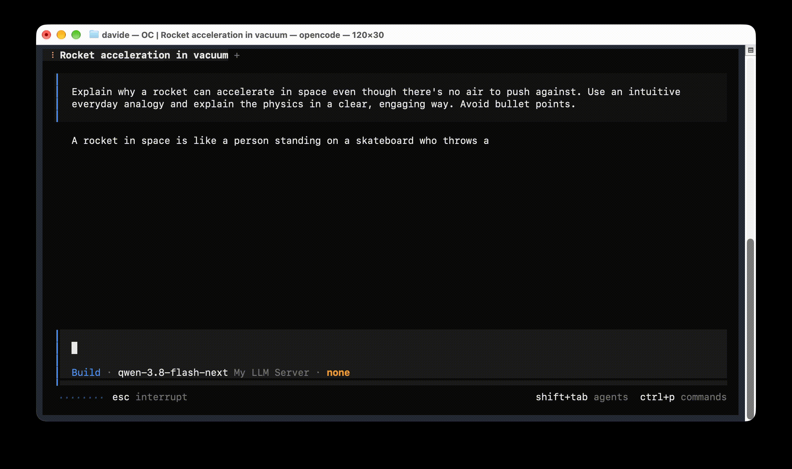

# MoEShift

**Run a local language model that’s bigger than your Mac’s memory.**

On Apple Silicon, MoEShift keeps the full model on your SSD and reads the
parts it needs as it works. That leaves more memory for the editor, browser and
other apps you use alongside your local assistant.

On a **MacBook Pro with an M5 Pro and 24 GB of memory**, Qwen 3.8 Flash Next
(125B) generated **about 15 tokens per second on a short prompt and 13 on a long
prompt**. MoEShift’s reported peak memory use was **about 8.5 GB**, with Safari,
Teams and IntelliJ open.

Use MoEShift with OpenCode or another OpenAI-compatible client.



## Requirements

You need an Apple Silicon Mac with at least **10 GB of RAM**, a fast SSD and
[Homebrew](https://brew.sh/). The benchmarks below used Macs with 24 GB and 32 GB of memory.

| Model in the setup wizard | Free SSD space needed |
|---|---:|
| Qwen 3.8 Flash Next (125B) | 120 GB |
| Inkling 2 Mini (26B) | 34 GB |
| Qwen3.6-35B-A3B (35B) | 61 GB |

Disk space includes both the downloaded model and the files MoEShift prepares for streaming.

## Quick start

```sh
brew install davide-troiani/moeshift/moeshift
moeshift
```

On first launch, choose a model. MoEShift downloads it, prepares the files
and starts a localhost server that handles one inference request at a time.

Configure your coding agent or API client with the OpenAI-compatible base URL
`http://127.0.0.1:8080/v1` and the model ID for your preset.

| Model | Model ID |
|---|---|
| Flash Next (125B) | `qwen-3.8-flash-next-rco-gsq-iq3-xxs` |
| Inkling 2 Mini (26B) | `inkling-2-mini` |
| Qwen3.6 (35B) | `qwen-3.6-35b-a3b-q6-xl` |

## Tested models and benchmarks

### Qwen 3.8 Flash Next on M5 Pro

The 125B model (GSQ-RCO IQ3_XXS) ran on a MacBook Pro with 24 GB of unified
memory, using the internal SSD and default MoEShift settings. The Mac was
plugged in, with the user's usual apps open.

| Measurement | Short prompt | Long prompt |
|---|---:|---:|
| Input tokens | 72 | 6,060 |
| Prompt processing | - | 374.15 tok/s |
| Text generation | **14.69 tok/s** | **13.14 tok/s** |
| Wall time for a 512-token reply | 36.71 s | 55.13 s |

Each column shows the median of three runs after one warmup, with prompt caching
disabled. Peak process memory was measured separately at approximately **8.5 GB**.
[Source and test conditions](https://github.com/davide-troiani/moeshift/issues/4)

### Qwen3.6-35B-A3B on M5

The 35B model (UD-Q6_K_XL) ran on a MacBook Pro with an M5 chip and 32 GB of
unified memory, using the internal SSD and default MoEShift settings. The Mac
was plugged in, with a code editor open and a video playing in the background.

| Measurement | Short prompt | Long prompt |
|---|---:|---:|
| Input tokens | 72 | 6,060 |
| Prompt processing | - | 473.75 tok/s |
| Text generation | **16.07 tok/s** | **14.94 tok/s** |
| Wall time for a 512-token reply | 33.64 s | 47.09 s |

Each column shows the median of three runs after one warmup. Combined resident
memory (RSS) for the router and worker peaked at approximately **7.7 GB**.
System swap stayed at **0 MB** throughout the run.
[Source and test conditions](https://github.com/davide-troiani/moeshift/issues/7)

[Browse community benchmarks](https://github.com/davide-troiani/moeshift/issues?q=is%3Aissue%20in%3Atitle%20benchmark)

## Configuration

To adjust memory use or conversation length, edit the JSON configuration and
restart MoEShift. [Configuration reference](configs/README.md)

All three wizard presets support SSD streaming. Other GGUF models load directly
and have different memory requirements. [Supported models](docs/supported-architectures.md) ·
[Architecture](docs/architecture.md)

## Contributing

MoEShift is in alpha. If you hit a problem during setup or while using a model,
[open an issue](https://github.com/davide-troiani/moeshift/issues/new/choose).
For fixes and pull requests, see the [contributing guide](CONTRIBUTING.md).

### Share a result from your Mac

Running a Mac with less than 24 GB? Tell us which model you tried, what else
was open and how your Mac felt while it answered. Someone with the same Mac
could use that information before downloading the model.
[Run the benchmark](benchmarks/README.md) and
[share your result](https://github.com/davide-troiani/moeshift/issues/new?template=benchmark_result.yml).

## Credits and license

MoEShift builds on [tc-mb/llama.cpp-omni](https://github.com/tc-mb/llama.cpp-omni),
[llama.cpp](https://github.com/ggml-org/llama.cpp) and
[ggml](https://github.com/ggml-org/ggml).

The setup wizard uses model files published by
[ISTA-DASLab](https://huggingface.co/ISTA-DASLab/Qwen3.8-Flash-Next-GSQ-RCO-GGUF)
and Unsloth ([Qwen3.6](https://huggingface.co/unsloth/Qwen3.6-35B-A3B-GGUF),
[Inkling 2 Mini](https://huggingface.co/unsloth/Inkling-2-Mini-GGUF)).

Original Git history and copyright notices are retained. See [LICENSE](LICENSE)
and the bundled third-party licenses. Model weights retain their own licenses.
