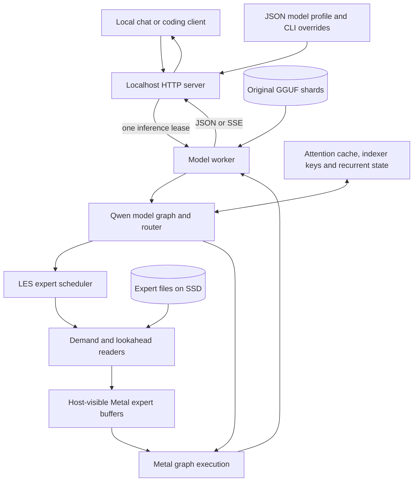
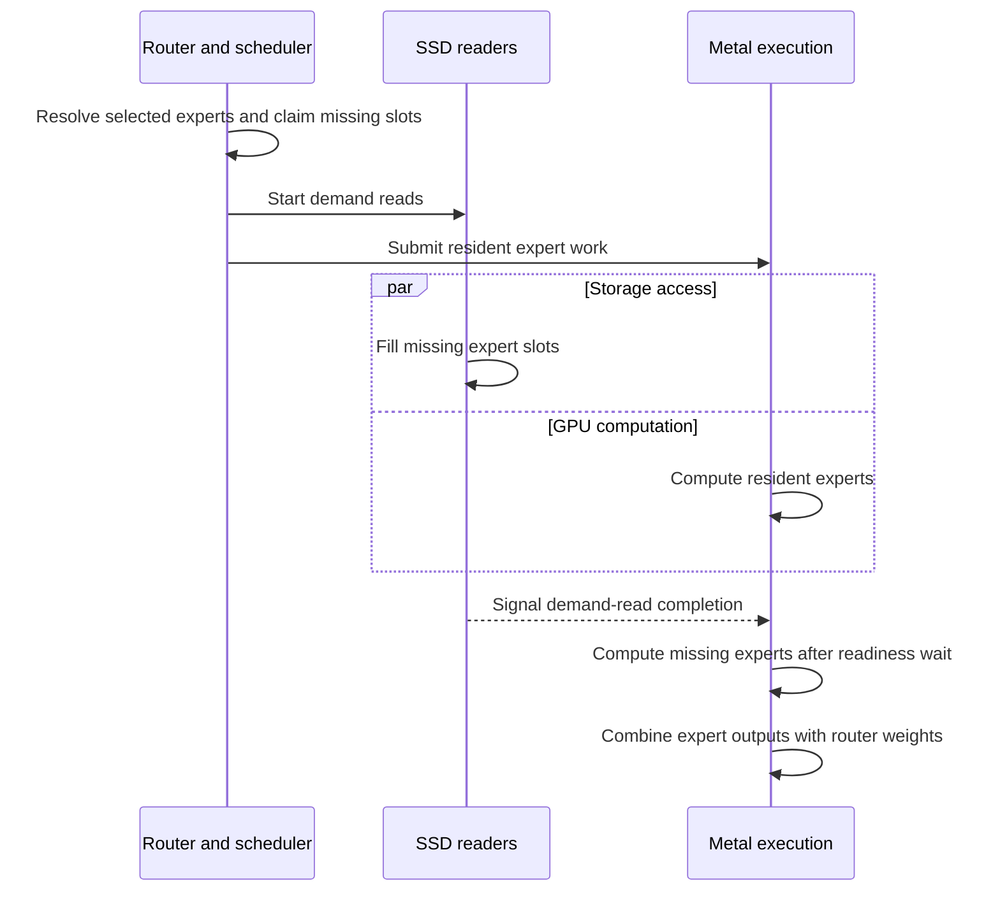
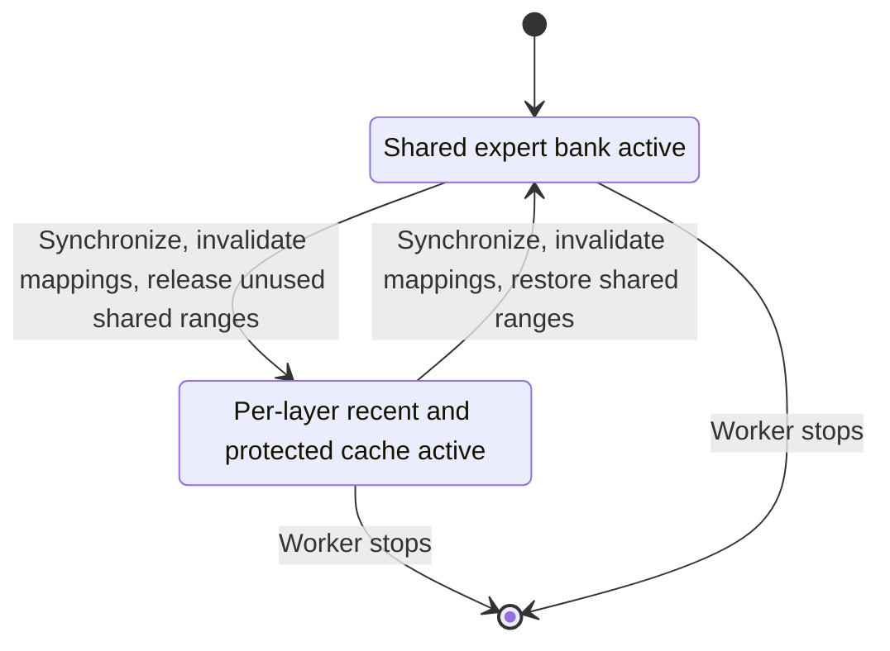

# MoEShift architecture

MoEShift is a local inference runtime for Apple Silicon Macs, optimized for
Qwen 3.8 Flash Next. Its architecture separates the memory needed to execute
selected experts from the storage needed to hold the complete model.

The public application is a localhost HTTP server. One model worker owns the
inference resources, and one inference request runs at a time. The standard
profile serves `qwen-3.8-flash-next-rco-gsq-iq3-xxs`.

## 1. Foundations and design boundaries

MoEShift builds on llama.cpp through llama.cpp-omni. Its upstream foundation is
**LES — Lookahead Expert Scheduling**: predict likely expert demand early,
load expert weights ahead of use, and overlap storage access with computation.
Repacking experts into contiguous storage makes those reads practical.

MoEShift develops this foundation into a Qwen runtime with adaptive prefill and
decode memory budgets, Metal resident/missing execution, a demand-LRFU protected
cache, growing context buffers, a key-only indexer cache, and explicit server and
worker lifetimes.

The model's actual router remains authoritative. Lookahead predictions influence
when weights are fetched and which cache entries are preferred for retention;
they do not replace selected experts or remove required computation. Expert
preparation preserves the original quantized weight bytes.

The supported application boundary is macOS on Apple Silicon with Metal and
localhost HTTP access. Inference parallelism is fixed to one; speculative
decoding is not part of the MoEShift execution profile.

## 2. Component model



| Component | Responsibility |
|---|---|
| HTTP server | Validate the requested model, serialize inference requests and proxy responses. |
| Model worker | Own model state, graph execution, expert readers and GPU keepalive. |
| Qwen graph | Compute routing, attention and expert outputs, then produce token logits. |
| LES scheduler | Resolve expert IDs to slots and coordinate demand reads, lookahead and cache ownership. |
| Metal backend | Execute graph operations and enforce readiness at the missing-expert boundary. |
| Expert store | Supply packed, quantized expert weights through explicit file reads. |

The worker is a separate process, reached through an internal localhost port.
This separates HTTP coordination from model resources while keeping their
lifetimes coupled.

## 3. Model storage contract

A usable model consists of three matching parts:

- All original GGUF shards, which retain model metadata and the original tensors.
- A manifest describing the extracted routed-expert tensors.
- The per-layer binary files referenced by that manifest.

Preparation groups the gate, up and down tensor data for each expert into
contiguous spans. The manifest records tensor identities, quantization, shapes,
file offsets and expert strides. The runtime can therefore locate the bytes for
a selected expert without loading the entire routed-expert tensor into memory.

Preparation copies bytes; it does not strip, rewrite or requantize the GGUFs.
Full verification compares tensor metadata and expert bytes with the originals.
Files from different models, quantizations or preparation runs must not be mixed.

Expert buffers are both CPU-addressable and available to Metal. Readers write
packed weights directly into their destination slots, avoiding a separate
private-GPU upload path. The operating system's file cache remains distinct from
the runtime's explicit expert cache.

## 4. Configuration and request lifecycle

The server resolves one JSON configuration and applies supported CLI overrides.
If no local or user configuration exists, the installed template is copied to
the user configuration path on first launch, preserving existing files.
Relative model paths resolve against the configuration's directory. Runtime
settings belong to the profile: inherited shell tuning variables are filtered
before the worker environment is constructed.

The public endpoints are health, model discovery, chat completions and text
completions. Model discovery describes configured profiles; server health does
not by itself establish model readiness.

An inference request acquires exclusive ownership of the inference path. The
server reuses a live worker for the same profile. Switching profiles stops the
previous worker before starting another. Requests arriving while inference is
busy wait for the current response to release that ownership; this includes the
entire lifetime of an SSE stream.

The worker has one inference slot. HTTP concurrency does not create concurrent
model execution. Client disconnection and server shutdown participate in request
cancellation. Normal shutdown stops admission, waits for the response lease to
be released, and terminates the worker.

The server first requests worker termination, then forcefully stops it if it
does not exit within the shutdown deadline. Independently, the worker monitors
its parent and exits if the main server disappears. This prevents an orphaned
worker from continuing inference or GPU keepalive after server termination.

## 5. Expert loading and Metal execution

### Demand and lookahead

The router produces the expert IDs required for the current token. The scheduler
looks up their slot mappings and determines which weights are ready. A completed
lookahead read can turn a future demand into a cache hit. An incorrect prediction
costs I/O or cache capacity, but a missed required expert still receives a demand
read and is computed.

Slots have an ownership state as well as a location. A slot claimed by a reader
is pending and cannot be evicted. Its mapping is published only after its bytes
have been written. Current-demand pins and pending-read ownership protect data
from replacement while it is needed.

### Resident/missing overlap

The optimized single-token Qwen decode graph separates selected experts into
resident and missing work. It requires Metal placement and a supported expert
operation layout; other graph shapes use the ordinary expert execution path.



Readiness is carried separately from expert identity through the graph's slot
representation. Cache ownership continues to use the underlying slot IDs.
Resident and missing phases populate the corresponding selected-expert output
positions. Outputs are combined before routing weights and the final reduction
are applied, retaining the selected-expert ordering.

The phase vocabulary is shared across scheduling and execution:

| Phase | Meaning |
|---|---|
| `ALL` | Ordinary expert execution without the resident/missing division. |
| `RESIDENT` | Compute selected experts whose weights are already available. |
| `MISSING` | Compute the remaining selected experts after their reads complete. |

Overlap reduces exposed I/O latency when resident computation is sufficient to
cover some reads. It does not eliminate SSD latency or guarantee that every
missing-expert read is hidden.

## 6. Expert caches and phase transitions

Prefill processes prompt microbatches using a shared expert bank. Decode uses
smaller per-layer expert windows so that repeated token generation does not
require retaining the full prefill bank.

The standard profile uses a 512-slot prefill bank, a zero-slot retained shared
decode bank, and a separate per-layer decode allocation of **39 slots**:
12 decode slots plus 3 prefetch slots form the 15-slot recent group, with
24 additional protected slots. A slot holds the packed tensors for one expert;
byte sizes can vary by layer and quantization.

### Demand-LRFU policy

Recent and protected groups share the same physical slot allocation. Hits and
admissions change logical ownership without copying expert weights between
buffers. Protected hits can return to the recent group; eligible recent victims
can move into the protected group.

For each layer and decode token, expert scores are updated before slot assignment:

```text
score[e] = 2^(-1/32) * score[e] + requested[e]
```

Each actually requested expert receives one vote, including cache hits and
misses. Prefetch alone contributes no vote. The protected group retains experts
according to this decayed demand score, using age to break score ties. Admission
compares an eligible recent victim against the weakest eligible protected entry.
Current requests and pending reads constrain victim selection; predicted experts
are preferentially preserved where possible.

The half-life is 32 tokens. This is an LRFU-inspired admission and replacement
policy, rather than a change to model routing. Increasing protected capacity can
reduce reads at the cost of more resident expert memory.

### Switching between prompt processing and generation



Phase transitions drain demand and lookahead work before changing memory ranges.
Mappings and replacement history are invalidated where the backing expert cache
is reset. Unused shared-bank pages become reclaimable while virtual addresses
remain reserved. A later prefill restores the ranges before they are used.
Per-layer decode windows remain separate from the shared-bank budget.

The prefill pipeline also stages upcoming expert reads to overlap storage access
with current-layer computation. Its staging memory and the graph's temporary
working memory are separate from persistent decode-cache capacity.

## 7. Context and memory model

Expert offloading addresses only one part of the process's memory requirements.

| Memory class | Lifetime and scaling |
|---|---|
| Resident model tensors | Loaded for the worker; determined by the model and placement. |
| Shared expert bank | Active prefill budget; reduced to the retained bank budget during decode. |
| Per-layer expert windows | Recent and protected decode capacity, set by the profile. |
| Attention context buffers | Grow with occupied context, up to configured capacity. |
| Indexer keys | Key-only context storage for sparse attention indexing. |
| Recurrent state and checkpoints | Preserve model state and configured checkpoint information. |
| Graph scratch and I/O staging | Temporary working memory determined by the active graph and phase. |

For supported cache layouts, context buffers start below maximum configured
capacity and grow when occupied cells require it. Growth is aligned and uses
geometric capacity increases bounded by the configured context limit. Existing
contents are copied into replacement buffers before live tensors are switched.
The execution graph's memory bindings are invalidated when growth requires it.
Growth can temporarily require both old and replacement allocations.

The sparse-attention indexer stores keys without allocating an unused value
cache. Its token positions follow the attention cache's slot layout. Key-only
storage remains key-only through buffer growth and state handling.

Configured capacity, allocated tensor bytes, reserved virtual addresses and
physical process footprint are different quantities. In particular, releasing
expert ranges does not imply an identical immediate reduction in whole-system
RAM usage, and a larger context limit does not require every growable cache cell
to be physically allocated at startup.

## 8. GPU keepalive

Brief I/O gaps can let the GPU lower its clock frequency. On M4 Pro, the GPU did
not return to maximum frequency quickly enough when computation resumed.
Keepalive maintains GPU activity during these gaps to help sustain frequency.
This frequency behavior has been observed only on M4 Pro.

Keepalive runs on a separate Metal queue with a small private workload and its
own buffer; it does not access model tensors. It belongs to the model worker,
starts before model loading, and stops with the worker. Initialization failure
prevents worker startup; a later keepalive Metal error ends that activity and is
logged. Keepalive increases idle GPU activity and power use and can be disabled
in the model profile.

## 9. Correctness boundaries and failures

The architecture relies on the following invariants:

- Model routing determines the required experts; lookahead only schedules reads.
- Pending expert bytes are not consumed as ready data.
- Reader ownership and current requests prevent unsafe slot replacement.
- Phase changes synchronize outstanding readers and GPU work before changing
  mappings or active memory ranges.
- The resident/missing path executes on Metal and respects the missing-read
  completion boundary.
- Context growth prepares replacement storage before switching live tensors.
- One response owns the inference lease until its completion or cancellation.
- Model resources belong to the worker, whose lifetime is bounded by the server.

Unsupported profile keys, invalid cache combinations and incompatible expert
layouts are rejected. Worker-load failure is returned as a server error. Resource
exhaustion or backend failure can still terminate a request or worker; the
architecture does not promise transparent replay or recovery of a partial reply.
Preserving expert identities and bytes is a design constraint, not a blanket
claim of bit-identical output across every backend and graph configuration.

## 10. Operational visibility

The runtime reports prompt-processing and generation timings, expert-cache
activity, I/O volume and phase diagnostics. Expert diagnostics are quiet by
default and can be enabled through the JSON profile. Logical cache hits, read
bytes, allocated memory and physical footprint answer different operational
questions and should be interpreted separately.

Performance depends on prompt length, cache state, SSD throughput, available
memory and GPU behavior. The repository README presents measured benchmarks;
[configuration](../configs/README.md) describes supported controls. Detailed
runtime topics are covered in [adaptive prefill](les/adaptive-prefill.md),
[protected decode cache](les/protected-decode-cache.md), and
[GPU keepalive](les/gpu-keepalive.md).
