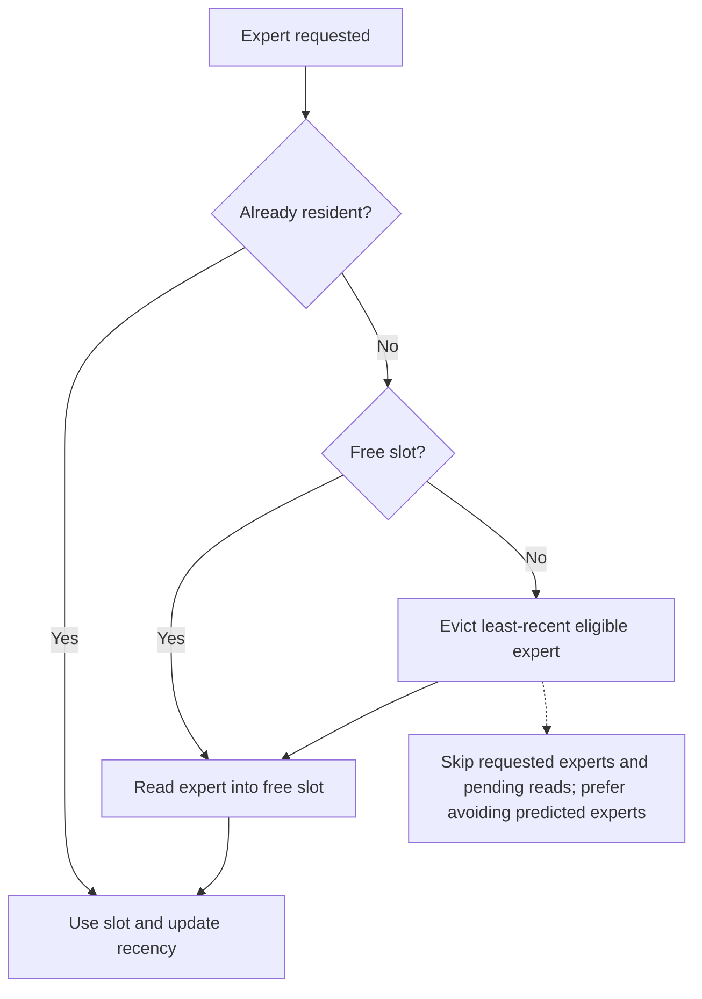
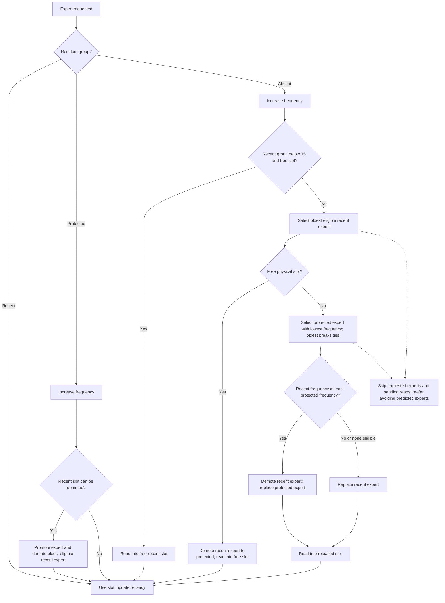

# Protected decode cache

Adaptive Qwen4Exp LES enables a two-tier cache when the per-layer decode window
is 12, prefetch depth is 3, and unified prefetch is enabled. Other window sizes
and partitioned prefetch retain the existing cache policy.

Each enabled layer has 15 recent slots and a configurable number of protected
slots. Set `LLAMA_MOE_PROTECTED_SLOTS` to a nonnegative integer; the default is
23. Zero disables the protected tier and restores the existing unified LRU.
The maximum is `min(prefill bank, number of experts, 1024) - 15`: with this
model and bank 512 the allowed range is 0–497. Invalid values are rejected at
model loading. The setting applies only to layers with the 12+3 configuration;
other layers retain their existing policy.

```sh
LLAMA_MOE_PROTECTED_SLOTS=32  # 32 protected slots per eligible layer
```

For the Qwen Flash IQ3 expert files used in the baseline, one slot holds one
expert's gate, up and down tensors. Their quantization varies by layer:

| MB per slot in one layer | Number of layers |
|---:|---:|
| 1.3056 | 8 |
| 1.4080 | 6 |
| 1.5104 | 6 |
| 1.7152 | 3 |
| 1.7664 | 1 |
| 1.8688 | 11 |
| 1.9712 | 4 |
| 2.1760 | 3 |
| 2.3296 | 6 |

An extra slot in **each of the 48 layers** reserves 83.8144 MB (decimal).
Thus 23 slots per layer reserve 1,927.7312 MB and 32 reserve 2,682.0608 MB,
plus small metadata. These are expert tensor allocation sizes, not a guarantee
of the process's physical footprint; model, quantization, alignment, other
allocations and OS accounting affect the actual result. The decode phase log
reports the configured slot count and the total expert bytes for active layers.

## Cache assignment: before and after

Before the protected tier, demand and prefetch shared one per-layer LRU window:



The protected tier uses two **logical groups in the same physical slots**. The
current algorithm keeps frequency counts for accesses outside the recent group.
Every 128 decode steps it halves all counts to reduce the weight of older usage.



Prefetch uses the same slot policy but does not know the target layer's current
request set when it claims a slot. A pending slot is unavailable for eviction;
a completed prefetch publishes its mapping. Promotions and demotions change
metadata rather than moving weights. Prefill/decode phase changes synchronize
readers and GPU work before invalidating mappings and frequency history.

One candidate-only measurement on Apple M4 Pro (24 GiB), with keepalive enabled,
context capacity 65536, and a short Italian prompt about virtual memory:

| Metric | Result |
|---|---:|
| Prompt including chat template | 77 tokens |
| Generated, including reasoning | 300 tokens |
| Decode | 9.0767 tokens/s |
| Decode time | 33.052 s |
| Peak decode physical footprint | 9.5835 decimal GB |

This is not a baseline comparison or proof of improved throughput or long-run
stability. Full-logit equivalence was not checked. OS file cache was not cleared;
preliminary server starts and an interrupted request preceded the completed run.

The standalone `test-les-protected-cache` checks capacity, pinned requests,
pending-read ownership, map consistency, reset, and frequency decay without a
model or GPU.
