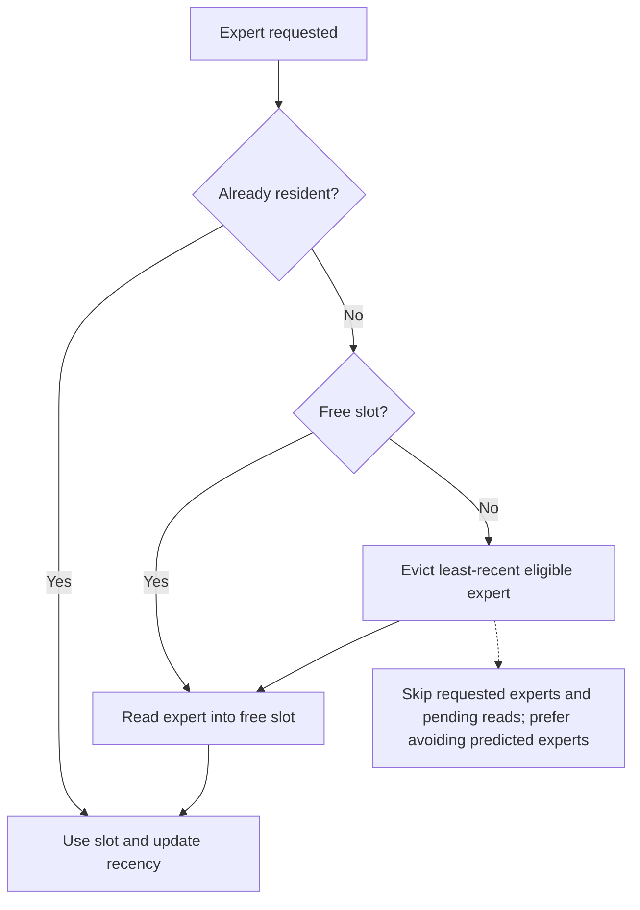
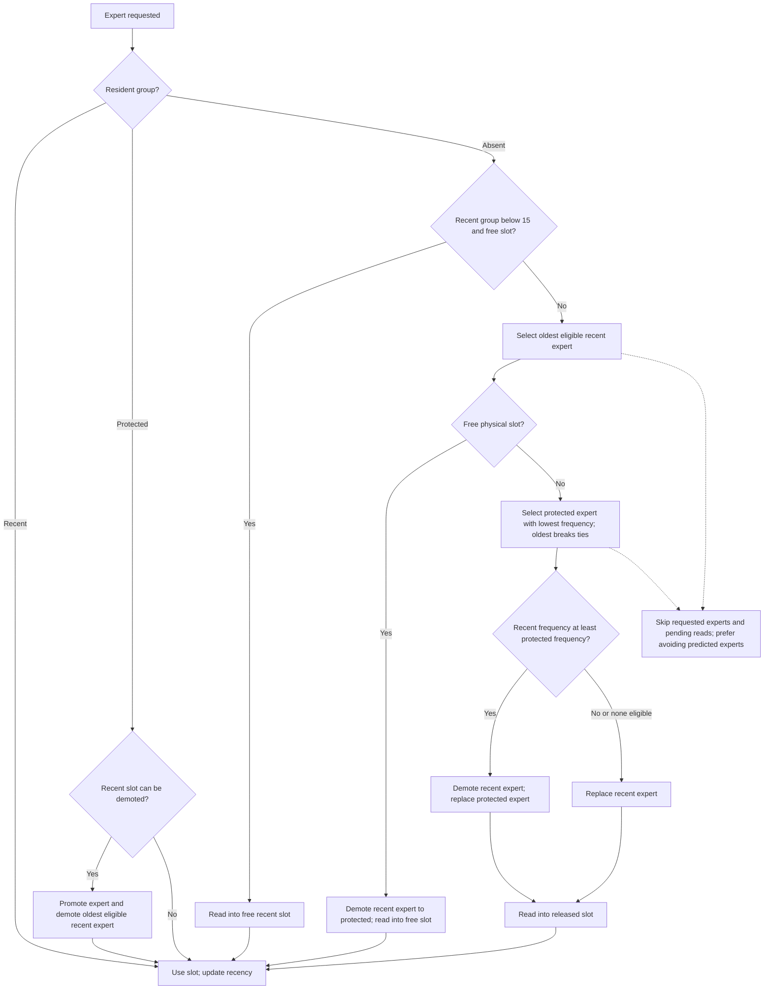

# Protected decode cache

Adaptive Qwen4Exp LES enables a two-tier cache when the per-layer decode window
is 12, prefetch depth is 3, and unified prefetch is enabled. Other window sizes
and partitioned prefetch retain the existing cache policy.

Each enabled layer has 15 recent slots and a configurable number of protected
slots. Set `LLAMA_MOE_PROTECTED_SLOTS` to a nonnegative integer; the default is
23. Zero disables the protected tier and restores the existing unified LRU.
The maximum is `min(prefill bank, number of experts, 1024) - 15`: with this
model and bank 512 the allowed range is 0–497. Invalid values are rejected at
model loading. The setting applies only to layers with the 12+3 configuration;
other layers retain their existing policy.

```sh
LLAMA_MOE_PROTECTED_SLOTS=32  # 32 protected slots per eligible layer
```

For the Qwen Flash IQ3 expert files used in the baseline, one slot holds one
expert's gate, up and down tensors. Their quantization varies by layer:

| MB per slot in one layer | Number of layers |
|---:|---:|
| 1.3056 | 8 |
| 1.4080 | 6 |
| 1.5104 | 6 |
| 1.7152 | 3 |
| 1.7664 | 1 |
| 1.8688 | 11 |
| 1.9712 | 4 |
| 2.1760 | 3 |
| 2.3296 | 6 |

An extra slot in **each of the 48 layers** reserves 83.8144 MB (decimal).
Thus 23 slots per layer reserve 1,927.7312 MB and 32 reserve 2,682.0608 MB,
plus small metadata. These are expert tensor allocation sizes, not a guarantee
of the process's physical footprint; model, quantization, alignment, other
allocations and OS accounting affect the actual result. The decode phase log
reports the configured slot count and the total expert bytes for active layers.

## Cache assignment: before and after

Before the protected tier, demand and prefetch shared one per-layer LRU window:



The protected tier uses two **logical groups in the same physical slots**.
At each decode step, it updates the exponentially aged demand scores before
allocating slots; prefetch does not update those scores.



Prefetch uses the same slot policy but does not know the target layer's current
request set when it claims a slot. A pending slot is unavailable for eviction;
a completed prefetch publishes its mapping. Promotions and demotions change
metadata rather than moving weights. Prefill/decode phase changes synchronize
readers and GPU work before invalidating mappings and frequency history.

## Demand LRFU

Protected admission and eviction use exponentially aged **actual router demand**.
Slot counts and the enabling conditions above do not change.

For each layer and decode token, before assigning any slots:

```text
score[expert] = 2^(-1/32) * score[expert] + is_requested_this_token[expert]
```

All demanded experts receive exactly one vote, including recent hits, protected
hits and misses. Prefetch claims/publications receive no votes. The existing
15-slot recent group, protected victim search, admission comparison, request
pins, prediction preference and pending-read ownership remain in place. Thus
this is an LRFU scoring/admission adaptation inside the existing two-tier cache,
not a replacement of the whole cache with textbook LRFU.

The score includes repeated recent hits and excludes unconsumed speculative reads.
A historical vote retains 1/16 of its weight after 128 tokens. The 32-token
half-life is an initial choice, **not a measured optimum for Qwen**;
short memory can discard useful experts with long reuse intervals.

The [LRFU paper](https://www.openu.ac.il/home/wiseman/2os/lru/lrfu.pdf) supplies
the recency-weighted frequency idea. The model-specific adaptation here is to
count a complete Qwen4Exp top-10 router set on the per-layer token clock, using
an exact 512-entry score vector rather than an approximate sketch. No routing,
expert weights, precision or accumulation order changes.

### What the supplied log establishes

`server_log_degradating.txt` uses 48 layers, 512 experts, top-10 routing and
**32 protected slots**, although its pasted command does not set that variable.
The server's `tg` is cumulative: its peak is 10.71 tokens/s at token 408 and
its last value is 9.89 at token 1281 (a 7.7% decrease). Differences between
timestamped progress records show a non-monotonic slowdown:

| Generated token interval | Tokens/s from timestamp differences |
|---|---:|
| 201–408 | 11.35 |
| 408–641 | 9.64 |
| 641–901 | 9.53 |
| 901–1147 | 10.02 |
| 1147–1281 | 8.72 |

The sampled `decode` records' hit ratio drops from 76.8% (steps 32–384) to
58.8% (1184–1280). These are **sparse per-token snapshots**, not window-wide hit
rates. `readall / span`, which does cover the logged spans, rises from about
256 to 385 MiB/token across those ranges. This supports investigating expert
reuse, but does not identify its cause: there are no per-expert routing traces,
physical-footprint samples, thermal measurements or separate attention timings.
Layer-0 `protected-cache hits` only counts protected-tier hits; it is not an
all-layer cache hit rate. Asynchronous reads can coexist with `pread_wall=0`.

No online replacement policy can guarantee constant decode speed or zero misses
at fixed capacity. Even an offline oracle cannot remove compulsory reads;
attention cost, memory pressure and storage/thermal behavior are outside this
policy. The expected benefit here is faster adaptation to changes in expert
demand, not a demonstrated elimination of the reported degradation.

### Memory and trying the prototype

The score vector already exists: 512 floats × 48 layers = 98,304 bytes for
the protected cache. No new expert slots, tensor buffers or history arrays are allocated.
At 32 protected slots, the protected tensors remain 2,682,060,800 bytes; at the
unchanged default of 23 they remain 1,927,731,200 bytes. **Equal allocations do
not prove a process footprint below 10,000,000,000 bytes.** The supplied log's
`metal_total` is allocation accounting, not a physical-footprint measurement.
Check the whole process, including startup and prefill, against that budget;
do not increase slots to obtain better cache results.

From the parent MiniCPM-V-Apps directory, build separately:

```sh
cmake -S llama.cpp-omni -B build-protected-lrfu \
  -DCMAKE_BUILD_TYPE=Release -DLLAMA_BUILD_TESTS=ON \
  -DGGML_METAL=ON -DGGML_NATIVE=ON
cmake --build build-protected-lrfu --target llama-les-server test-les-protected-cache -j 8
```

Use the server command/environment in the supplied log, changing only its
executable to `./build-protected-lrfu/bin/llama-les-server` and explicitly adding:

```sh
export LLAMA_MOE_PROTECTED_SLOTS=32
```

Check the first decode phase log for
`recent=15 protected=32 total=47 policy=demand-lrfu half_life=32`.
Use a **single new long request with a different prompt** (for example, a detailed
comparison of database indexing, query planning and recovery, up to 2048 generated
tokens). Keep context capacity, quantization, prefetch and hardware conditions
fixed. Measure throughput from differences between timestamped `n_decoded`
records, alongside `readall/span` and physical footprint. Do not compare only
the cumulative `tg`, nor infer a speedup by comparing different prompts.
Stop and reject the run if it exceeds the memory budget; reducing protected
slots is allowed but constitutes a different cache-capacity experiment.

Validation performed for this prototype: standalone synthetic tests with
AddressSanitizer/UndefinedBehaviorSanitizer, covering LRFU at 1, 23,
32 and 64 protected slots, score accounting, decay, phase change, predictions,
pins, pending reads, reset and map consistency. The server was built separately.
No model inference, repeat of the supplied test, A/B/A run, throughput claim,
full-logit comparison or physical-footprint certification was performed.

## Earlier measurement (legacy policy)

One candidate-only measurement on Apple M4 Pro (24 GiB), with keepalive enabled,
context capacity 65536, and a short Italian prompt about virtual memory:

| Metric | Result |
|---|---:|
| Prompt including chat template | 77 tokens |
| Generated, including reasoning | 300 tokens |
| Decode | 9.0767 tokens/s |
| Decode time | 33.052 s |
| Peak decode physical footprint | 9.5835 decimal GB |

This is not a baseline comparison or proof of improved throughput or long-run
stability. Full-logit equivalence was not checked. OS file cache was not cleared;
preliminary server starts and an interrupted request preceded the completed run.

The standalone `test-les-protected-cache` checks capacity, pinned requests,
pending-read ownership, map consistency, reset, and frequency decay without a
model or GPU.
